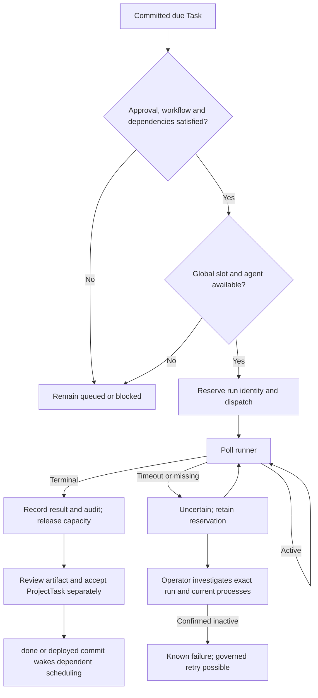

# Messages execution and recovery

Last updated: 2026-10-24

This is the engineering reference for the AgentDemand dispatch pipeline. The ecosystem process
contract is `/root/.hermes/foundation/30_docs/FORGEHUB_MESSAGE.md`; the sole general MCP usage
guide is `/root/.hermes/shared-skills/forgehub/SKILL.md`. Do not duplicate its parameters or catalog.

## State and flow

`AgentDemand.status` governs message lifecycle; `dispatch_status` governs execution;
`agent_processed_at` records inbox acknowledgment. None substitutes for ProjectTask acceptance.

Self-addressed Tasks use this same pipeline. MCP omission of the recipient resolves to the sender.
Incubation is explicitly non-runnable until accepted. Callers must select the actual project directory;
the inherited default directory does not infer a project from the message body.

## Implementation map

| Source | Responsibility |
|---|---|
| `backend/app/api/routes/demand.py:create_demand_and_notify` | Resolve sender/target, classify work and signal committed due work. |
| `demand.py:run_scheduled_dispatch_pass`, `_execute_dispatch` | Eligibility, dependency gate, serialized reservation and dispatch. |
| `demand.py:_in_flight_dispatch_filter`, `_dispatch_slots`, `_agents_already_running` | Count active/reserved/uncertain attempts for global and per-agent capacity. |
| `demand.py:run_dispatch_completion_pass`, `get_dispatch_status`, `_finalize_dispatch` | Poll, lock, recheck run identity and record terminal outcomes. |
| `demand.py:run_dispatch_timeout_pass` | Preserve uncertainty when a deadline expires. |
| `backend/app/core/demand_workflow.py:requires_reconciliation`, `decide_demand`, `record_transition` | Govern investigation, exact-run confirmation, retry authorization and audit history. |
| `demand.py:list_pending_for_agent` | Acknowledge mail; archive completed informational returns with audit while retaining runnable Tasks. |
| `backend/app/core/feedback.py:deliver_feedback`, `run_feedback_pass` | Deliver eligible outcomes with refreshed eligibility under a lock; suppress historical communications. |
| `backend/app/api/routes/task.py:update_task` | Validate task transitions and wake scheduling after committed done/deployed status. |
| `host-bridge/forgehub_messages_mcp.py:send_agent_message` | Explicit self-target and scheduling for omitted recipients. |

## Concurrency and recovery invariants

Capture a run ID before network polling. Re-read the demand under a row lock and check that exact
ID before applying either active or terminal state. Refresh existing ORM objects so cached values
cannot bypass the check. Concurrent finalizers must not generate duplicate returns.

A missing runner record never proves inactivity. Failed uncertain attempts with known IDs stay
in the completion sweep and capacity accounting. Runner-confirmed terminal results finalize the
same attempt. Unknown states leave it unresolved. Operator inactive confirmation requires the
exact prior ID and recorded current process evidence; it preserves identity and attempt history.

Historical records may be reconciled without restoration. Results and audit remain, while archived
or consolidated demands create no new replies, channel narration, failure notifications, or external
feedback during terminal reconciliation. Feedback rechecks eligibility after locking to avoid racing
with archive/consolidation. No blanket purge or clearing of run IDs is a recovery mechanism.

## Completion report (2026-10-24)

A clean process exit is not completed work. The runner input ends with the contract in
`backend/app/core/completion_report.py`, asking for a final `STATUS: DONE | PARTIAL | BLOCKED`
line with evidence. `_finalize_dispatch` records `completed` only for `DONE`; `PARTIAL`,
`BLOCKED` or a missing line (a reply cut short, an ignored contract) record `failed` with the reason
in `dispatch_error`, keep `dispatch_result`, notify, create no return message and release no
dependent work. That failure is known, not uncertain, so reprocessing stays available within the
retry budget. The contract is added only to the runner input; the Telegram dispatch notice and
the stored body stay as written. Cause: on 2026-10-24 runs that stopped mid-task ("Now let me...")
with exit 0 were filed under Completed.

TaskDependency gates linked message dispatch until predecessors are accepted `done`/`deployed`.
A successful process moves execution evidence toward review; it cannot silently accept the
ProjectTask. Retry budgets, approvals, global capacity and agent exclusion continue to apply.

## Review and regression coverage

`backend/app/tests/test_demand_consolidation.py` covers uncertain terminal/active recovery,
404 preservation, replaced-run races, self-addressed dispatch, informational acknowledgment,
historical recovery without communication, feedback eligibility races, and dependency release only
after predecessor acceptance. `test_factory_mcp.py` covers omitted-recipient self-work and deferred
self-scheduling. `test_task.py` covers dependency gates and task-status scheduling wake-up.
Other focused suites cover dispatch reservations, feedback and workflow authorization.

The implementation owner reported 135 relevant regression tests passing. The isolated full backend
run reported 949 passed, 21 failed, 4 errors and 1 skipped; see
`/tmp/forgehub-dispatch-suite.log`. This is not a wholly passing suite and does not establish that
its failures predate the change. No tests were run solely for this documentation edit.

## Production observation — 2026-10-21

The implementation owner verified 47 historical uncertain blocks, all retained as archived:
32 were reconciled from runner-confirmed completed results; 15 missing runner records were
confirmed inactive after host process inventory. Recovery backups are under
`/root/.hermes/profiles/athos/state-snapshots/messages-dispatch-2026-10-21/` and
`/root/.hermes/profiles/athos/state-snapshots/messages-dispatch-global-2026-10-21/`.
The final observed pipeline state had messages #39622, #39623 and #39624 at dispatch status
`completed`, each retaining a distinct run ID, with no in-flight entries or live chats. Earlier,
#39624 had correctly queued behind Athos before capacity became available.
These observations verify process completion, recovery and dispatch ordering; they do not establish
acceptance of the routines' business deliverables. This is a dated snapshot of the observed state.
