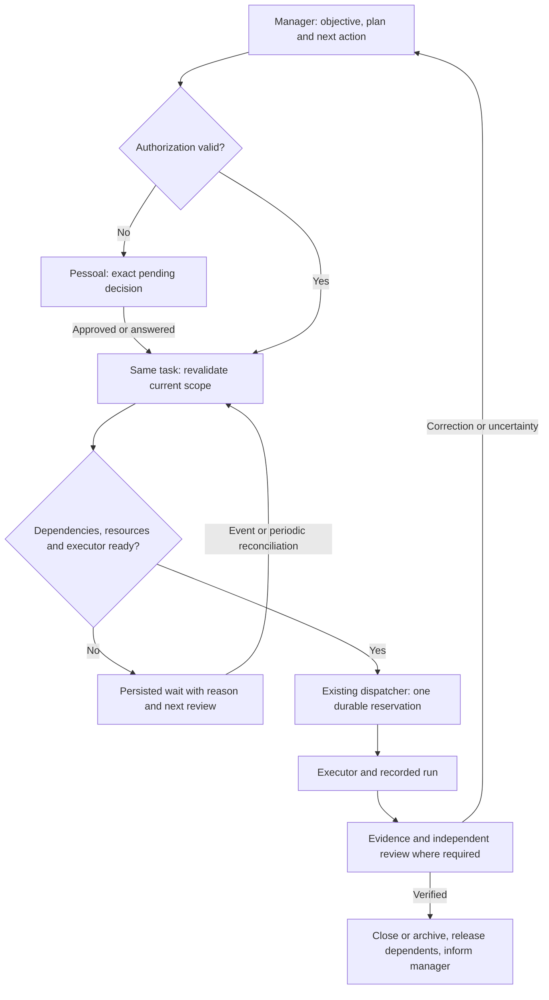

# Messages: durable orchestration and operator labels

**Status:** consolidated context for the existing solution. Responsibilities and acceptance
requirements below are not a claim that every automatic management feature is enabled. See the
implementation/publication ledger and gap tests in
`docs/superpowers/plans/2026-11-09-mission-messages-maturation.md`.

## Required behavior

Marcelo clarified the operational contract on 2026-11-09: authorized work must remain
tracked when no executor is available. It stays in Messages → Execução, tagged
**Aguardando executor**, with an explanation of quota, occupancy, availability or assignment.
Pending authorization and registered operator decisions remain distinct and link to their
actual location in Pessoal. A right-side legend documents labels by Messages folder.

Labels describe backend facts; they do not grant authority, create another runner, or change
task ownership. One canonical business task links its messages, decisions, assignments and run
attempts. Distinct attempts/reviews may have their own existing IDs with explicit relationships;
they must not become duplicate business tasks. Standalone work keeps its existing message/owner
identity when there is no ProjectTask, without requiring a synthetic mission.

## Two complementary orchestration layers

The canonical Foundation separation still applies: Messages dispatches and follows communication;
the Task/Project/Mission domains own planning, priority, declared dependencies, acceptance and
work evidence. The task manager and message dispatcher share these records, rather than keeping
two competing copies of task progress.

| Layer | Owner | Decisions |
|---|---|---|
| Operational orchestration | ForgeHub backend and existing Messages dispatcher | Current eligibility, queue order, resource/dependency gates, available compatible executor, capacity, reservation, timeouts, event recovery and delivery |
| Work management | Designated manager agent within its registered role and project/mission policy | Interpret the objective, plan/decompose work, declare dependencies and resource needs, assess evidence, propose correction or cancellation and choose the next permitted action |
| Aggregate supervision | Existing Operação 24x7 routines, views and watchdog | Combine the same mission/task/message/run facts, detect unexplained waits or missing cycles and request reevaluation from the existing owner; never maintain another task state or independently approve work |
| Final authority | Marcelo through the applicable Pessoal decision panel | Missing or changed authorization, flagged decisions, scope/risk/budget/autonomy changes, and actions reserved by the existing governance policy |

The manager proposes or requests a guarded action. The backend validates current authority and
facts before applying it. A model recommendation, label, quoted authorization or completed
diagnosis never substitutes for a real authorization or accepted delivery.

## Management rules and decision boundaries

| Decision | Rule and authority | Required record |
|---|---|---|
| Authorize work | Use the existing authorization/delegation for the exact current scope; a change invalidates approval where the guarded workflow requires it | Actor, content/version, scope and decision |
| Set priority | The manager acts within the approved project/mission policy; dependencies and resource locks still apply | Priority, rationale and affected work |
| Run in parallel | The manager declares independence; the backend verifies dependency completion, exclusive resource targets and global/per-agent capacity | Explicit dependency/target records and distinct run reservations |
| Await an executor | Preserve authorized work in Execução with an executor-wait label; lack of quota is not another approval request | Current reason, availability evidence/reset and persisted task |
| Reassign | Apply only an eligible existing substitution or guarded reassignment; keep fixed reviewers, mission baselines, privacy and executor-bound approvals intact | Previous/new executor, reason and current policy checks |
| Resume after a wait | Re-read authorization, current scope, dependencies, availability and delivery evidence; do not blindly replay a previously started attempt | New decision tied to current versions |
| Handle a failure | Diagnose the recorded attempt and preserve partial effects; an uncertain outcome blocks replay until reconciliation | Run identity, original result/error and investigation |
| Retry or increase budget | Respect the current retry limit and source authorization; budget increases and flagged retries follow the existing operator gate | Cause, attempt identity, allowed budget and authorization |
| Change scope or acceptance | Request the applicable new approval/change request; the manager cannot silently redefine the authorized deliverable | Scope/version difference, proposed action and decision |
| Complete work | Require accepted evidence and independent review where mandated; task, message and mission acceptance remain distinct | Evidence, verifier/reviewer and terminal transition |
| Retire redundant work | Archive only when current structural or delivery evidence justifies it; tentative similarity stays a suggestion | Exact source binding, evidence and archive reason |
| Ask Marcelo | Register one concrete pending decision/question linked to the original work and its correct Pessoal destination | Question, context, recommendation, consequence and decision |

Every active item needs an owner, current state, reason for waiting and next reevaluation path.
One blocked task must not stop independent eligible work. Decisions update the original record;
they do not create another executable copy of the same request.

The mission management cycle exists behind `MISSION_CYCLE_ENABLED` and remains disabled in this
publication. Labels and Messages maintenance do not activate it or extend an agent's authority.
This contract describes the boundaries for integrating management, not a claim that all automatic
manager decisions are already enabled.

## Lifecycle

1. **Intake:** persist the message, scope, responsible agent, authorization and working
   directory. Losing an in-process wake-up must not lose the record.
2. **Reconciliation:** compare the current request with verified deliveries and related work.
   A quota block from yesterday does not prove work is still outstanding today. Similarity
   suggests a relationship; it is not proof of completion.
3. **Eligibility:** enforce current authorization, dependencies, mission baseline, source
   permissions and execution context. A pending question/authorization is an operator decision;
   lack of an executor is an operational wait.
4. **Assignment:** respect executor compatibility, identity/privacy, active status, quota,
   capacity and fixed-agent/reviewer rules. Existing failover handles permitted substitutions;
   a label must never relax those restrictions. Preserve reassignment history.
5. **Reservation:** the existing dispatcher reserves under its database admission lock, keeps
   one active run per agent, and persists a run identity before asking the host to start it.
   Concurrent wake-ups cannot independently start the same task.
6. **Execution and verification:** record results on the original task. An active or uncertain
   attempt cannot be repeated merely because a timeout or quota event occurred. Reconcile its
   recorded run first. A completed diagnosis does not complete the original problem.
7. **Closure:** independently verified deliveries and completed diagnostic records can leave
   the active inbox for archive, preserving original attempts, evidence, reasons and links.

## Recovery when events are lost

The in-process signal is an accelerator. PostgreSQL remains authoritative. The existing
periodic dispatch sweep and Messages analysis maintenance discover eligible persisted work
after a lost event or restart. Analysis jobs have durable item progress, fenced leases and
bounded restart attempts; slow model calls renew their lease without retaining row locks.

Re-evaluation follows changes to the source, questions, executor configuration, quota expiry,
dependencies, mission/baseline records, related work and delivery evidence. Before changing a
task and again before reservation, the backend checks the current versions. Failed provider
analysis preserves pending work and applies only independently proven decisions.

## Increasing volume

- Existing mission priority and queue age govern order, subject to dependencies and capacity.
- Reuse one dispatcher and its global/per-agent limits; avoid a new queue per screen or label.
- Coalesce equivalent active analysis requests and process bounded batches with durable cursors.
- Use batch classification and shared SQL freshness for counts and rows, rather than a model
  call or database query per visible badge.
- Keep routine executor waits in Execução. Surface genuine human decisions with their reason
  and destination; do not turn every provider failure into another request for approval.
- Preserve evidence for uncertain outcomes and content-bound delivery vetoes even during
  rollback. Reassignment must not resurrect previously delivered work.

## Presentation contract

`DemandOut` exposes bounded `message_labels`, optional execution wait reason/reset time,
classification summary, and operator decision/destination. The labels are a fixed localized
catalog. Advisory duplicate/obsolete indications remain visibly tentative until verified.

The legend groups explanations under Entrada, Saída, Incubações, Execução, Concluídas and
Arquivo. Every label explains the current condition and next step. Operator links distinguish
Tarefas dos agentes, Incubações and Aprovações Moodle. The catalog is documented in
`docs/product/messages-labels.md`.
