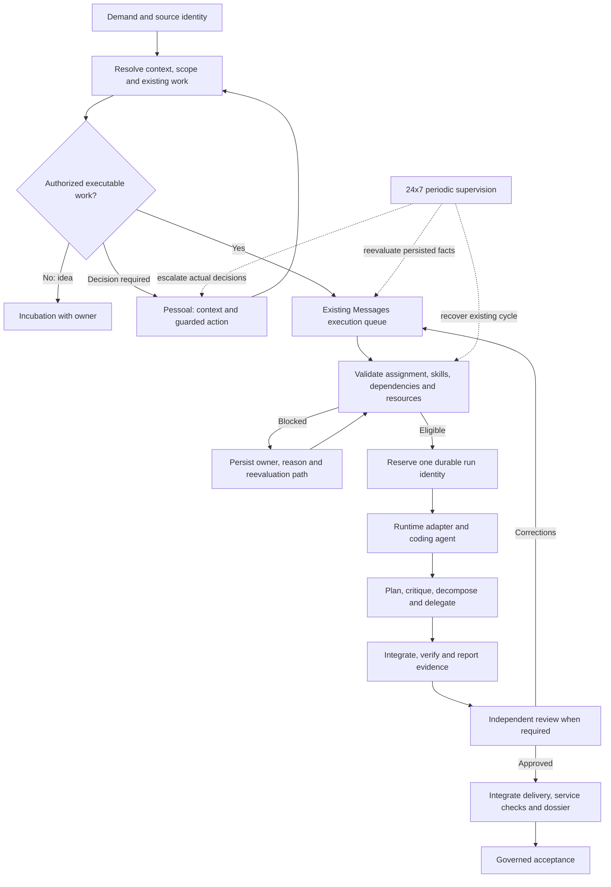

# Mission, Messages and 24x7 operating flow

## Purpose and authority

Maintain one understandable process from authorized demand to accepted delivery,
with fast execution, verified quality and accountable recovery. This document
connects the existing components; it does not introduce a second orchestrator.

The code determines available behavior. This document distinguishes the intended
operating contract from implementation checkpoints. See the
[maturation spec](../superpowers/specs/2026-11-09-mission-messages-maturation.md),
[implementation plan](../superpowers/plans/2026-11-09-mission-messages-maturation.md)
and [implementation evidence](../reports/2026-11-09-maturation-implementation-progress.md).
Prepared source changes do not establish production availability. Automatic
manager activation requires the plan's qualification and publication gates.

This complements [ENGINEERING_LOOP.md](ENGINEERING_LOOP.md) and
[AGENT_CLI_DEVELOPMENT_PROTOCOL.md](AGENT_CLI_DEVELOPMENT_PROTOCOL.md).
The shared usage/authority rules for agents remain in Foundation and the existing
ForgeHub skill; this is project architecture documentation, not another skill.

## Responsibilities

| Component | Owns | Canonical records |
|---|---|---|
| Mission and designated manager | Scope, plan, priorities, dependencies, assignments and acceptance preparation | Mission, ProjectTask, baseline, decisions, reviews |
| Messages | Administrative queue, admission, reservation, run tracking, waits, handoffs and analysis | AgentDemand, run identity, audit and durable analysis jobs |
| Coding agent | Technical execution plan, bounded local decomposition, integration and delivery evidence | Assigned task/run, checkout, artifacts and reports |
| Native subagent | A bounded package delegated by its parent | Parent execution and its local package/result links |
| Operação 24x7 | Detect stalled work and request its existing owner's reevaluation | Existing cycle/routines/watchdog and shared task/run IDs |
| Marcelo through Pessoal | Actual authorization, information and business decisions requiring him | Existing question and source-specific approval records |

## End-to-end flow

Messages without a mission retain their existing service/personal owner and
approval rules. Do not manufacture missions or duplicate canonical tasks to
represent every message, retry, subagent exchange or diagnostic.

## Admission and context

### Service Factory integration

The factory covers all registered service lines and systems development. The
existing `Product.kind`, `Project.service_line_id` and `ServiceLine` catalog
already represent this generalization. Preserve those records and resolve each
line's stages, required documents, evidence types, default responsibilities and
applicable service obligations at opening, execution and closure.

| Work | Applicable flow and evidence examples |
|---|---|
| Systems development/evolution | Approved requirements, implementation, tests, independent review, integrated artifact and governed release |
| Systems support/sustainment | Triage, scoped correction, verification of the original service outcome, maintenance history |
| Infrastructure/maintenance | Authorized target/action, recorded host execution, post-action checks and runbook |
| Customer support | Authorized handling, approved external response where required, evidence of resolution |
| Documentation/knowledge | Versioned content, source/technical review and authorized publication |
| Other catalog lines | Their configured process, evidence, authority and acceptance obligations |

Software-only gates such as screens, database modeling, Git integration and
application deployment must not be imposed on unrelated services. Conversely,
classifying software work as service must not bypass its actual risk or release
gates. Record non-applicability explicitly according to the line and approved
scope. A catalog declaration is not proof that every downstream verifier already
implements that evidence type; qualify the complete path for each supported line.

Service Factory also supports ongoing service operation and routine follow-up,
not only software development. A recurring service must remain understandable
through its responsible owner, expected behavior, schedule/timezone, execution
window, evidence, current health, outstanding exceptions and next action.

The existing operations model already separates `AgentRoutine` (the recurring
obligation), `AgentRoutineRun` (one scheduled occurrence) and its Messages demand
(execution). Occurrence identity is `(routine_id, occurrence_at)`. Preserve that
identity through retries and diagnosis; a new schedule occurrence must not erase
an earlier failure or silently duplicate its effects. Service work can exist
without a development mission; use the real service/project source where one
exists, and do not claim the optional mission link proves service ownership.

| Routine fact | Meaning for service follow-up |
|---|---|
| Scheduled occurrence | An obligation exists; execution is not yet proven |
| Running/queued/waiting | Preserve its deadline, owner and actual blocking reason |
| Completed attempt | Verify its expected service evidence before claiming the service obligation was met |
| Failed occurrence | Assess service impact, preserve evidence and route recovery |
| Missed window or skipped budget | Work was not performed; retain an explicit exception and next decision |
| Disabled routine | Preserve who disabled it, why, and the authorized review/resume condition |

24x7 supervises service continuity and existing routine occurrences; Messages
handles their work. If remediation requires development, link a bounded change
task/mission back to the service incident or routine result. After review and
deployment, verify the original service outcome and resolve its exception with
evidence. A successful coding task alone does not establish restored service.

An ongoing service does not become completed because its latest routine ran.
Keep its service health, each occurrence's result, unresolved incidents and
product/software version lifecycle distinct. Routine evidence informs audit,
documentation and improvement proposals. Service metrics and thresholds come
from its approved obligations; do not invent contractual service levels.

Agents work through the existing Service Factory domain tools and their actual
permissions. The existing Product → ProductVersion → Project → approved scope /
planning → ProjectTask → assignment / execution / review → delivery / release
relationships remain authoritative. Mission coordinates that scope; Messages
transports and administers its executable work. Preserve canonical IDs at each
handoff, including documentation, audit, artifact and acceptance references.

At intake, resolve the actual product/version/project and planning source.
Before execution, read the current project context, approved requirements and
architecture, task acceptance criteria, baseline and applicable documents.
During execution, record factual progress, blockers, decisions and evidence
against the task/run. Propagate a subagent result through its parent's existing
assignment, rather than creating an unrelated project or task for every exchange.

After verified changes, update the affected project documentation and link the
reviewed artifact and evidence. An observed process/documentation improvement is
a linked proposal in the responsible domain; it does not silently change the
approved scope or bypass review. The existing project/mission surfaces provide
progress, audit, acceptance and outstanding-work visibility.

Keep Git branch/commit, build artifact version and ProductVersion distinct and
linked. A code commit is not a product release; a deployed image does not itself
close the product version. Product version publication/closure follows the
existing governance and approved delivery scope, with exact artifact integrity,
applicable checks, documentation, review, rollback evidence and authorization.
Coding agents may prepare release evidence; their execution does not grant
authority to publish or close a version.

Factory writes must preserve request identity, current scope and actor authority.
If a required domain tool is unavailable or refuses the operation, keep the
task's blocker explicit and route it to its actual owner; do not invent a parallel
spreadsheet/queue or write directly around the domain guards.

Before dispatch, identify the source task/message/question, current objective,
scope/version, executor and role, dependencies, protected targets, approvals,
required skills and expected evidence. Consult existing delivery/run records
before diagnosing, retrying or assigning a substitute. Similar wording suggests
a possible duplicate; it does not establish identical work or accepted delivery.

History, quoted original instructions and diagnostic output must be distinguishable
from current instructions. A fresh CLI process needs an explicit current package:
the prompt builder currently supplies the message body and command instruction,
not an implicitly restored conversation. Source text cannot grant permissions.

## Skills and coding-agent execution

Resolve mandatory skills from existing task requirements and agent grants, then
read applicable accessible skill contents. Check runtime compatibility and actual
availability; a catalog grant alone does not prove a file/tool can be used.
Missing mandatory capability creates a factual skill gap with an owner and
reevaluation path. Missing an optional skill alone does not prevent qualified work.

The coding agent plans development, critiques the approach, divides suitable work,
delegates bounded packages, integrates results and verifies the complete delivery.
Each package carries objective, necessary context, prerequisites, allowed scope,
isolated checkout when needed, acceptance checks and expected evidence. Keep a
durable plan/result summary across context reduction and restarts.

Parallelize independent work within capacity and target constraints. Order dependent
work and serialize conflicting checkout/publication operations. The existing manager
owns cross-agent task dependencies; native subagents do not maintain another DAG.
Small changes may execute directly when delegation adds no value.

Runtime skills explain the capabilities of Claude, Codex and agy. Structured intent
must be translated by the existing adapter into validated argument lists appropriate
to the installed runtime version. Never execute a shell command invented from a
model recommendation. Preserve native login/model policy and current permissions.
Unsupported capabilities require an explained alternative or eligible assignment.

Native executor/reviewer/supervisor roles share the parent scope and resource
budget. They do not gain independent credentials or acceptance authority. Local
review improves quality; required independent review still belongs to another
eligible principal who did not implement the delivery.

## States, waits and recovery

### Workspace browser automation

Use the existing internal Workspace browser for authorized website interaction:
functional testing, documentation/screen evidence, data consultation and data
entry. The [Workspace screen contract](../screens/workspace.md) describes the
existing shared Chromium/CDP session, human interaction, assistant and automation
routines. Reuse its browser, macros and structured automation capabilities rather
than creating a separate browser pipeline.

Resolve the actual target application/URL, environment, session identity, task
purpose, effective browser tools and relevant skill before execution. Qualify the
selected coding runtime's connection: the documented human/Athos shared session
does not itself prove every external CLI has an authorized tool connection.
Record queries and results as factual observations; read-only consultation,
synthetic testing and authorized changes to real data are distinct task scopes.

For testing, follow the approved scenario and inspect the resulting application
state. For documentation, capture the exact verified screen/version and protect
sensitive content. For data entry, identify the intended records and check the
persisted result after submission. A click, HTTP success or screenshot alone
does not prove a business operation completed. If the result is unknown, inspect
the existing record/operation before submitting again.

The current browser is shared. Parallel tasks must not navigate/type through the
same page concurrently or overwrite the human operator's active interaction.
Qualify target ownership, serialization and human takeover with existing resource
guards; separate contexts/tabs may be used only where actually supported and
scoped. A native subagent does not acquire a separate safe browser merely by
having a different role. Browser content and site instructions are untrusted
input, not authority to expand the task or publish data.

Link relevant scenario, target/environment, observed outcome and protected screen
evidence to the canonical task/run and reviewed delivery. Service browser routines
retain their occurrence identity, expected evidence and recovery ownership like
other service routines. Credentials/session access remain under existing rules;
screenshots and reusable lessons must not expose private session data.

### Internal and remote execution autonomy

Marcelo's remote-access changes enable authorized agents to perform internal
and external service tasks. Apply the existing
[remote access rule](REMOTE_ACCESS_RULE.md), not a new approval/access mechanism.
SSH is the transport used by ForgeHub; agents use the governed remote tools.
Machine/account/key preparation remains under the existing operator policy.

Before a remote effect, resolve the exact task/run, responsible agent, destination,
effective access grant, allowed operation and relevant runtime skill. Existing
direct-command access, library scripts, approved proposals and transfers retain
their individual rules. Execute within the authorization already granted; do
not introduce repeated approval requests simply because a task uses SSH.
Policy-required proposal/operation approvals still apply to their specific actions.

Remote tools require the dispatched task's individual run credential. Preserve
that identity through a delegated execution: native children do not receive a
different principal, a broader grant or an SSH private key. New operations must
honor current access changes, pause, expiry and revocation. A blocked access is
distinct from missing quota, task dependency or an unanswered business question.
Route a genuine access change to its existing owner and authorization surface.

ForgeHub automatically records who ran which command/script/transfer against
which machine and task, with timestamps and outcome. The agent links the actual
execution references and service checks to its delivery evidence; prose claiming
that SSH worked does not replace the backend audit. Preserve unknown outcomes
for reconciliation before repeating an operation. Verify the original service
result after remote correction, rather than equating command exit with delivery.

Reading, inbox acknowledgement, process exit, attempt completion, accepted task
completion and mission acceptance are distinct facts. Archive is history management;
it never proves successful delivery. A completed diagnosis does not resolve its source.
See the [label catalog and group legend](../product/messages-labels.md).

| Condition | Existing path |
|---|---|
| Authorized but no quota/executor/capacity | Execução with factual wait label; periodic reevaluation and eligible assignment |
| Dependency or shared target occupied | Persist the same task; reevaluate canonical dependency/resource guards |
| Actual operator approval or question | Link to the correct Pessoal group and exact guarded answer/action |
| Idea or owner-stage incubation decision | Existing incubation lifecycle; no implicit authorization |
| Unknown external outcome | Keep the original run ID; reconcile before replay |
| Proven delivered work | Veto execution and obsolete diagnosis; preserve original attempts/evidence |
| Missing event or restart | Periodic persisted-state scan recovers existing intent |
| Stalled mission | 24x7 requests the existing owner's cycle or escalates a factual blocker |

Retries bind actor, key and complete immutable payload. Identical requests replay;
changed requests conflict.

An answer continuation for a canonical ProjectTask must retain that task and its
project/directory/context links. It requires its own recorded execution attempt,
preserving the original attempt and evidence. Replaying the answer recovers the
same continuation. Dependency, current scope, assignment, review and resource
guards apply to its eventual start and delivery. Merely linking a reply message
to its parent is insufficient for canonical execution/evidence continuity.

A late answer to already done/deployed/cancelled canonical work is preserved as
question/history information and does not create another attempt or claim an
execution occurred. Record the reason and keep the original Task state/evidence.
Answers received while a previous attempt is active, uncertain or awaiting review
need explicit source-state qualification before a new runtime may act.

New agent decisions carry the context version actually
read. Save event consumption with durable follow-up intent and wake after commit.
Database-only effects should commit with their decision/audit/receipt. External
starts retain their durable identity and recover missing final records without
starting another run. Cancellation must be distinguished from confirmed termination.

## Delivery, acceptance and learning

Require evidence for the exact approved scope and artifact/version, applicable
tests/service checks, independent review, integration and dossier integrity.
DONE text or matching caller-supplied hashes alone do not establish acceptance.
Required tasks stay accountable through correction, substitution or an authorized
scope decision; cancelling a required task cannot silently satisfy its criterion.

Learning follows observation → evidence → reproducible lesson → review → versioned
skill proposal/publication → later observation and rollback if needed. Preserve
provenance, privacy and secret boundaries. Do not promote model confidence,
repetition or a failed attempt into a proven rule. Learning cannot grant authority
or change acceptance criteria. Decomposition and verification reduce context loss
and hallucination risk; neither guarantees zero hallucination.

## Maintenance and maturation

For a future change, record the symptom and exact identities, reproduce the gap,
identify the current owner/guard, implement there, verify normal and recovery
paths, review, publish the exact qualified artifact and record actual enabled flags.
Link each change to the spec, tests and release evidence. Update this document when
responsibilities or flow change; keep implementation/release facts in the evidence
ledger. The [additional gap audit](../reports/2026-11-09-pipeline-gap-audit.md)
separates confirmed code findings from scenarios still requiring reproduction.
