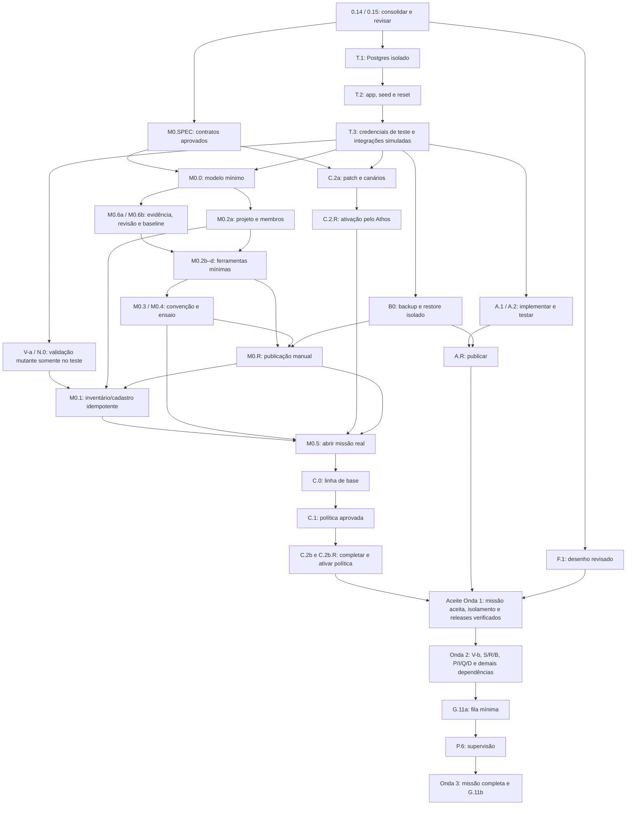

# Fases de implementação


Ordem: **validar o Service Factory primeiro**, racionalizar o que está duplicado, ligar os componentes nele, depois a Missão.
As linhas despacháveis viram ProjectTask com dependência (`TaskDependency`) no projeto comum "Plano integrado" do produto Ecossistema Foundation, após validação e liberação da baseline. Linhas de resumo são desmembradas antes do cadastro. Não criar registros de execução nesta consolidação. Quem escreve não revisa o próprio
código, nem a publicação (nós `.R`) do que escreveu. Na Onda 1 (D-1, 28/10: Codex sem cota) Porthus implementa e Dartan
revisa; publicações são revisadas pelo Aegis. Aramis volta como executor ou revisor por nova atribuição. Independência
registrada por ids. Claude Code é o runtime do Porthus, não outro revisor.

**Atualizado:** 27/10/2026. Primeira onda detalhada em [12](12-primeira-onda.md) e
[onda1-tarefas.json](onda1-tarefas.json). O JSON é a fonte canônica das arestas, responsáveis e aceites da Onda 1; estas tabelas e o resumo do 12 são projeções verificadas da mesma baseline. Nenhum item foi implementado por esta edição. Evidências históricas de 24/10 não substituem
validação atual.

**Regra de despacho (D1):** toda tarefa de implementação tem especificação com arquivos/contratos,
migrations, autorização, testes, evidência e rollback aprovados antes do código. Um dono responde
pela entrega; colaboradores não são revisores de conteúdo que escreveram. A coluna Verificador
identifica a revisão independente, e não uma delegação automática de poder de aprovar produção.

### Fase 0 — Revisão crítica do plano (antes da Onda 1)

Nenhuma implementação começa antes desta fase sair. Roteiro completo, perguntas e formato do parecer:
[revisao/ROTEIRO-DE-REVISAO.md](revisao/ROTEIRO-DE-REVISAO.md).

**Como é registrada:** o Service Factory ainda não foi validado (Fase V), então a revisão roda como
tarefas do Messages com o contrato `STATUS: DONE` e o parecer no resultado. Quando a M0 registrar o
plano como projeto, estas tarefas entram como os primeiros itens dele, com os pareceres como evidência.

| # | Tarefa | Dono | Verificador | Depende | Aceite |
|---|---|---|---|---|---|
| 0.1 | Parecer: arquitetura e coerência entre camadas | Porthus | Aramis | — | Parecer no formato do roteiro |
| 0.2 | Parecer: viabilidade técnica (backend, MCP, ForgeVault em .NET) | Aramis | Porthus | — | Idem |
| 0.3 | Parecer: telas, celular, identidade visual, testes no navegador | Dartan | Porthus | — | Idem |
| 0.4 | Parecer: governança, papéis, gates, autonomia, Foundation | Athos | Aegis | — | Idem |
| 0.5 | Parecer: ondas, dependências, tamanho das tarefas, caminho crítico | Atlas | Daedalus | — | Idem |
| 0.6 | Parecer: executabilidade das tarefas e fluxo git/CI | Daedalus | Porthus | — | Idem |
| 0.7 | Parecer: área de teste, deploy, incidentes, restauração | Hephaestus | Aegis | — | Idem |
| 0.8 | Parecer: segurança, identidade, navegador na internet | Aegis | Aramis | — | Idem |
| 0.9 | Parecer: LGPD (contexto, clientes, coleta de dados) | Themis | Aegis | — | Idem |
| 0.10 | Parecer: memória e contexto | Mnemosyne | Aegis | — | Idem |
| 0.11 | Parecer: clareza do conjunto e validação da documentação | Scriba | Daedalus | — | Idem |
| 0.12 | Parecer: funil, marketing, redes sociais | Kairos | Daedalus | — | Idem |
| 0.13 | **Consolidação histórica** (`revisao/CONSOLIDADO.md`): problemas agrupados, análise e propostas | Porthus | Aramis | 0.1–0.12 | Nenhum parecer sem análise |
| 0.14 | **Rodada cruzada** sobre os documentos consolidados, modelos e a matriz da Onda 1: alguma decisão cria contradição entre camadas? | Athos | Porthus | 0.13 | Pareceres da 2ª rodada |
| 0.15 | **Registro da aprovação de consolidação** do Marcelo e dos limites/defaults em 09; corrigir documentos com referência aos itens do consolidado | Porthus (registro), Marcelo (autoridade) | Athos | 0.14 | Nenhum item "bloqueia" sem decisão; documentos atualizados |

### Fase V — Validação do Service Factory (agente opera, Marcelo acompanha, Aramis corrige)

**Base histórica:** 107 testes do Service Factory passaram em 24/10 (e2e, cockpit, MCP, escopo, versão,
tarefas, evidência, aprovação governada, produto, projeto, backlog, governança). Falta o uso real.

A validação tem duas passadas, para não depender de algo que ainda não existe:
- **V-a, pela tela/API:** o roteiro abaixo inteiro na área de teste, **depois de T.2 e T.3**, com Marcelo acompanhando, Aramis corrigindo e Porthus verificando.
- **V-b, um agente pelo MCP:** o mesmo roteiro, só com as ferramentas que o MCP já tem. O que o
  agente não conseguir fazer vira a lista exata da P.1.

| # | Tarefa | Dono | Verificador | Depende | Aceite |
|---|---|---|---|---|---|
| V-a | Validar roteiro V.1–V.15 por tela/API com dados fictícios, relatando defeitos e correções | Porthus | Dartan | T.2, T.3 | Relatório com prova de cada passo; produção intacta, sem envios externos |
| V-b | Repetir o roteiro pelo MCP existente e registrar precisamente o que faltar para P.1 | Atlas (apoio Aramis) | Porthus | V-a, M0.2c, M0.2d | Sem inventar ferramentas; lacunas viram tarefas por contrato, não falhas escondidas |

| # | Roteiro | Resultado esperado |
|---|---|---|
| V.1 | Criar produto interno (sem cliente) e versão no Cockpit | Aparece na árvore; produto nunca fica sem versão |
| V.2 | Concepção → submeter → decidir | Gate de aprovação respeitado |
| V.3 | Mapa do Sistema: elementos, relações, validar | Validação aponta inconsistências |
| V.4 | Autorizar planejamento da entrega | Projetos, membros e tarefas criados com responsável |
| V.5 | Planejamento: Planning Items, tarefas, dependências | Tarefa com predecessor aberto não despacha (409) |
| V.6 | Despachar tarefa a um agente | Mensagem no Messages, execução registrada, `STATUS: DONE` → `reported` → evidência verificada |
| V.7 | Aprovação de `project_task` | Aprovar despacha; falha vira notificação |
| V.8 | Ligar documento à tarefa e à fase (Docs) | Aparece nos dois lados |
| V.9 | Fechar versão | Bloqueia com tarefa aberta; trava escopo/telas/planejamento depois de publicada |
| V.10 | Cockpit e Telemetria | Fases, custo por projeto, telemetria por agente coerentes |
| V.11 | Ticket Darckware → "Criar projeto" | Projeto com cliente e origem; idempotente |
| V.12 | Celular (390 px) nas telas acima | Sem corte nem rolagem lateral |
| V.13 | Pipeline do projeto: estágios, artefatos obrigatórios, gate; e o Progresso governado | Estágio não conclui sem artefato; definir se o Progresso é redundante |
| V.14 | Plano do projeto, baseline, change request e WBS | Baseline congela; change request altera o escopo com aprovação |
| V.15 | "Gerar via IA" nas fases | Rascunho gerado, nunca aplicado sem revisão |

**V-a/N.0 não enviam e-mail/Telegram nem usam portal, cliente, segredo ou máquina reais.** V.11 usa evento Darckware simulado e os testes de despacho usam agentes/execuções de teste. V-b após M0.2 usa ferramentas atuais e registra lacunas; não depende de a P.1 estar pronta.

Cada defeito encontrado vira tarefa no projeto "Validação do Service Factory" e é corrigido antes da
Fase I. Entregável: relatório da validação (documento ligado ao projeto) com o que passou e o que foi corrigido.

### Fase P — Agentes operam o Service Factory; Marcelo supervisiona e anota (seção 1.1)

Hoje o MCP já cobre: listar e ler projetos, planning items, tarefas, telas e ERD; criar ideia de
concepção, documento de conceito, escopo, telas, modelo de banco, planning item e tarefa; atualizar
status de tarefa; reportar bloqueio de governança; liberar execução; criar e publicar versão; e a
manutenção remota. **Não existe** anotação nas entidades do Service Factory.

| # | Tarefa | Dono | Verificador | Depende | Aceite |
|---|---|---|---|---|---|
| P.1 | **Completar o restante do MCP** (M0.2a–d já cobrem a primeira fatia, com Porthus executando e Dartan revisando na Onda 1); dividir a lista da V-b em tarefas por ferramenta antes de despachar. **Completar o MCP** para o ciclo inteiro sem a tela, a partir da lista da V-b: dependências, atribuição, despacho, relatar execução com evidência, atualizar planning item e estágio do pipeline, change request, anexar documento/artefato (`DocLink`), criar item no Sustentação, ler a linha do tempo | Aramis | Porthus | V-b, R.2 | Um agente percorre o roteiro da Fase V inteiro só pelo MCP |
| P.2 | **Anotações** (`annotations`, polimórfica como `AuditEvent`): em produto, versão, projeto, fase, tarefa, missão, máquina e cliente; tipos `instrução`, `contexto`, `decisão`, `correção`, `observação`; autor (Marcelo ou agente); fixar; validade; anexos por `DocLink` (upload vai para `/docs`). Agente nunca edita nem apaga anotação do Marcelo | Aramis | Porthus | V | Testes de permissão; histórico auditado |
| P.3 | **Painel "Anotações e documentos"** reutilizável em todas as telas de detalhe do Service Factory, da Missão e do Agent Activity; escrever em Markdown, anexar arquivo, fixar; pelo celular também | Dartan | Porthus | P.2 | 390 px; `ConfirmDialog` para arquivar |
| P.4 | **Contexto herdado no despacho:** ao despachar uma tarefa, o corpo inclui as anotações ativas da tarefa e dos níveis acima (missão → projeto → versão → produto), em ordem de precedência (instrução do Marcelo primeiro), resumidas e com os documentos citados; MCP `get_task_context` devolve o mesmo pacote | Aramis | Porthus | P.2, C.2b.R | Teste: anotação do projeto chega a toda tarefa do projeto; anotação privada respeita o escopo da Fase C |
| P.5 | **Linha do tempo por projeto/missão:** tudo o que os agentes fizeram (criações, mudanças de status, despachos, execuções, evidências, documentos, execuções remotas), filtrável por agente, com "o que mudou desde a sua última visita" | Aramis (apoio: Dartan) | Porthus | P.1 | Toda ação de agente aparece com autor e link |
| P.6 | **Visão de supervisão** no Cockpit: o que espera o Marcelo (G.11a, fila mínima da Onda 2), o que travou, o que os agentes mudaram nas últimas 24 h, e anotar com um toque a partir de qualquer item | Dartan | Porthus | P.5, G.11a | Celular; um toque leva do item à anotação |
| P.7 | **Anotação vira conhecimento:** promover uma anotação para documento do projeto, Base de Conhecimento ou Foundation, por tarefa (Scriba/Mnemosyne/Athos, Fase C) | Aramis | Porthus | P.2, C.3 | Promoção registrada; a anotação aponta o destino |
| P.9 | **Anotar pelo Telegram:** o Marcelo dita uma anotação ou instrução para um projeto/tarefa ("anota no projeto X: ...") ao Athos ou à Maia, que registram pelo MCP com ele como autor | Aramis (apoio: Athos (skill)) | Porthus | P.2 | Anotação aparece no projeto com origem Telegram |
| P.8 | Agentes também anotam (`observação`, `decisão`) quando algo for útil para o próximo agente ou para o Marcelo; skill `forgehub` ensina quando anotar e quando abrir tarefa | Aramis (apoio: Athos (skill)) | Porthus | P.2 | Skill atualizada; anotações de agente distinguíveis das do Marcelo |

### Fase R — Racionalização (um caminho para cada coisa)

| # | Tarefa | Dono | Verificador | Depende | Aceite |
|---|---|---|---|---|---|
| R.1 | Aposentar Execution Waves/Work Packages/runner e o restante da Orquestração (rotas 410, telas e card simulado do Cockpit removidos; tabelas vazias removidas por migration), **preservando `PROJECT_AGENT_ROLES`, `ProjectAgentMembership` (inclusive can_review, can_approve, allocation_percent e limites), `TaskExecutionReview` e todas as FKs/evidências**; mover membros ao domínio de projeto e revisão ao de tarefas antes de aposentar as rotas/runner legados | Aramis (apoio: Dartan) | Porthus | V | Nenhuma rota de execução fora do Messages; membros, permissões e revisões intactos; ida/volta da migration e revisão independente testadas |
| R.2 | Templates de Pipeline por tipo de projeto (implementação, sustentação, serviço, missão) com estágios e artefatos obrigatórios | Atlas (conteúdo) (apoio: Aramis) | Porthus | V.13 | Projeto novo recebe o pipeline do seu tipo |
| R.3 | Progresso governado: fundir no Pipeline ou aposentar, conforme V.13 | Aramis | Porthus | V.13 | Uma só noção de "estágio concluído" |
| R.4 | Revisão | Porthus | Daedalus | R.1–R.3 | Aprovação registrada |

### Fase B — Base cadastral

| # | Tarefa | Dono | Verificador | Aceite |
|---|---|---|---|---|
| B.1 | Produtos a partir dos repositórios reais em `/root/project`: Ecossistema Foundation (inclui Hermes, Tailscale, RustDesk), ForgeHub, ForgeRouter, ForgeVault, Darckware, CoreTI, Duplica, SAEDAS, FileNest, OsintKey, Marketing, Serviços de Manutenção; internos sem cliente, os de cliente com o cliente; versão em produção de cada um | Atlas, Marcelo aprova a lista | Daedalus | No Cockpit; interno marcado |
| B.2 | Projeto permanente "Sustentação" por produto (manutenção corretiva, preventiva, atualização) | Atlas | Daedalus | Um por produto, sem cliente |
| B.3 | Marcar "Interno" na tela e no Cockpit para projeto sem cliente | Dartan | Porthus | Visível na lista e no detalhe |
| B.4 | **Importar o estado atual** de cada produto: pasta e repositório (`working_directory_path`, remoto git), documentos existentes (`docs/`, `CLAUDE.md`, specs e planos), pendências abertas (`docs/PENDENCIAS.md`, Messages em aberto, Incubação) como planning items, e o que está em produção (Deploy) | Atlas + Scriba, Marcelo revisa | Daedalus | O Service Factory reflete o que existe hoje, não começa vazio |

### Fase I — Interligações de execução

| # | Tarefa | Dono | Verificador | Depende | Aceite |
|---|---|---|---|---|---|
| I.1 | Tipo de item `maintenance` e `service` no planejamento (além dos atuais) | Aramis | Porthus | V | Migration do CHECK; filtros na tela |
| I.2 | Tarefa de manutenção com **máquinas e scripts autorizados** (mesmo registro do "Pedir ao agente"), preenchidos na tarefa | Aramis (apoio: Dartan) | Porthus | I.1 | Agente fora das máquinas/scripts da tarefa → 403 |
| I.3 | `PARTIAL`/`BLOCKED` do Messages → ProjectTask `blocked` com motivo; `DONE` segue para verificação | Aramis | Porthus | V | Testes dos três desfechos |
| I.4 | Despacho de tarefa de manutenção traz as máquinas e a instrução no corpo (como "Pedir ao agente") | Aramis | Porthus | I.2 | Corpo inclui ids e `message_number` |
| I.5 | Evidência `host_execution:<id>`: verificada só se todas as máquinas terminaram `ok`; execuções aparecem na tarefa | Aramis | Porthus | I.2 | Execução com uma máquina falha → evidência `failed` |
| I.6 | Tarefa de projeto de cliente concluída → lançar horas no Darckware (mesma regra do `:resolve`, minutos obrigatórios) | Aramis | Porthus | B.1 | Horas aparecem na franquia; auditadas |
| I.7 | Check do Auditor falho → tarefa no projeto Sustentação do produto do dono (dedupe por check), não Task solta | Aramis | Porthus | B.2 | Check verde fecha a tarefa com evidência |
| I.8 | Incubação "promover" e Canal `:dispatch-task` com opção de criar Planning Item/ProjectTask | Aramis (apoio: Dartan) | Porthus | V | Origem registrada na tarefa |
| I.10 | Agendamento de script de manutenção → tarefa recorrente no Sustentação: cada execução vira evidência; falha abre tarefa para o dono | Aramis | Porthus | B.2, I.5 | Execução agendada aparece na tarefa; falha gera tarefa |
| I.11 | Sugestão de responsável no planejamento pelas skills/tools/MCP do agente e pela carta (`TaskRequiredSkill`) | Aramis (apoio: Dartan) | Porthus | V | Tarefa mostra agentes compatíveis |
| I.12 | Falhas operacionais viram trabalho no Sustentação do produto: cron/script órfão, backup externo, disco, provedor ForgeRouter, Hindsight | Aramis | Porthus | B.2 | Dedupe por fonte; fecha sozinha quando a fonte volta ao normal |
| I.13 | **Incidente:** tipo de item `incident` com severidade; incidente crítico fura o silêncio noturno do Telegram, abre tarefa no Sustentação para o dono, e só fecha com causa, correção, evidência e relatório pós-incidente (documento da fase e lição na G.7) | Aramis (apoio: Hephaestus) | Porthus | I.7 | Incidente simulado percorre o fluxo inteiro |
| I.9 | Revisão | Porthus | Daedalus | I.1–I.8, I.10–I.13 | Aprovação registrada |

### Fase D — Documentação, manual e pasta do projeto

| # | Tarefa | Dono | Verificador | Depende | Aceite |
|---|---|---|---|---|---|
| D.1 | Documentos obrigatórios vêm do estágio do Pipeline do projeto (R.2); cada um gera uma tarefa `documentation` (Scriba por padrão) | Aramis | Porthus | R.2 | Estágio sem o documento não conclui |
| D.2 | Documento entregue = Artefato versionado + `DocLink` ao arquivo em `/docs/<produto>/<projeto>/`; fase só vai a `done` com os artefatos do estágio | Aramis | Porthus | D.1 | Teste: fase não fecha sem artefato |
| D.3 | Manutenção e serviço geram registro de atendimento (o quê, onde, evidência, horas) ligado à tarefa e, no cliente, ao ticket | Aramis | Porthus | I.5, I.6 | Registro visível no projeto e no Darckware |
| D.4 | Publicar versão gera notas da versão a partir das tarefas e documentos | Aramis | Porthus | D.2 | `release_notes` preenchido; revisável antes de publicar |
| D.5 | Aba "Documentos" no projeto e na fase (artefatos, versões, arquivos) | Dartan | Porthus | D.2 | Celular; link para o Docs |
| D.7 | **Estrutura padrão da pasta do projeto** (padrões 18 e 19 da Foundation), mantida pelo Service Factory em `<working_directory_path>/docs/`: `00-INDICE.md` (mapa com estado de cada documento), `PRD.md`, `ESCOPO.md` (telas e regras), `BANCO-DE-DADOS.md` (modelo e ERD derivados), `DEPLOY.md` (ambientes, instalações, como publicar e reverter), `METODOLOGIA.md` (padrões e specs adotados, D.8), `SPEC-TECNOLOGIA.md`, `adr/` (decisões), `design/` (D.12), `MANUAL/` (D.9), `CHANGELOG.md` (notas de cada versão, D.4). Cada arquivo tem cabeçalho com estado, dono e data | Aramis (apoio: Scriba (conteúdo)) | Porthus | D.2, R.2 | Projeto novo nasce com a estrutura; o índice reflete o estado real |
| D.8 | **Contrato do projeto:** no Service Factory, por projeto, declara metodologia, padrões da stack adotados (com versão e estado de cada um), stack técnica, design system e identidade visual (D.12), banco, ambientes de deploy e restrições; gera `METODOLOGIA.md` e vai junto em todo despacho de tarefa do projeto (com as anotações, P.4) | Aramis (apoio: Dartan) | Porthus | P.4 | Tarefa despachada cita o contrato; mudar o contrato exige anotação ou aprovação |
| D.9 | **Manual do sistema** por versão: gerado a partir do escopo (telas, regras, fluxos), revisado pelo Scriba e publicado em `docs/MANUAL/` e no portal do cliente quando for projeto de cliente (E.2) | Scriba (apoio: Aramis) | Porthus | D.7 | Publicar versão sem manual atualizado pede confirmação explícita |
| D.10 | **Guia para os agentes na pasta** (`AGENTS.md`/`CLAUDE.md` do projeto), gerado do contrato, das anotações fixadas e da estrutura, para que Claude Code, Codex e agy leiam o contexto ao abrir a pasta | Aramis | Porthus | D.8, P.2 | Guia atualizado a cada mudança do contrato; seção gerada delimitada (o resto do arquivo não é tocado) |
| D.11 | **Tela "Documentação do projeto"** e auditoria: documentos exigidos × existentes, estado (rascunho/em revisão/aprovado), última atualização × última mudança de código, divergência entre a pasta e o Service Factory; check no Auditor por projeto | Aramis (apoio: Dartan) | Porthus | D.7 | Documento desatualizado ou divergente aparece na tela e vira tarefa |
| D.12 | **Identidade visual do projeto** no Service Factory, materializada em `docs/design/`: logomarca (variações horizontal, vertical, símbolo, monocromática, fundo claro e escuro, em SVG e PNG), favicon e ícone de app; paleta de cores com tokens claro/escuro e contraste verificado (WCAG AA); tipografia; ícones; tom de voz; `DESIGN-SYSTEM.md` (componentes, espaçamentos, estados); `SCREEN-TEMPLATES.md`; protótipos de tela (o MCP já salva HTML); e um arquivo de tokens aplicável no código (variáveis CSS / tema Tailwind do padrão 02) | Dartan (apoio: Aramis (upload e geração)) | Porthus | D.7 | Projeto com tela não libera tarefa de UI sem identidade aprovada; contraste reprovado aparece na tela |
| D.13 | **Homologação de design** como estágio do pipeline (R.2) antes de implementar telas: o Marcelo aprova logomarca, paleta e protótipos; tarefas de UI despachadas ao Dartan levam os tokens, a logomarca e o protótipo aprovado no contexto; no produto Darckware vale também a homologação própria (`docs/CONTROLE_DE_DESENVOLVIMENTO.md` e skill `darckware-design`) | Dartan (apoio: Porthus (revisão)) | Porthus | D.12, R.2, P.4 | Tela implementada diferente do protótipo aprovado é apontada na revisão |
| D.6 | Publicar versão cria a Release, liga às instalações do Deploy e mostra a versão em produção | Aramis (apoio: Dartan) | Porthus | D.4 | Deploy exibe a versão; release com notas |

### Fase Q — Qualidade, ambientes e entrega do código

Lacuna encontrada na revisão: não há CI, não há branch/worktree por tarefa (dois agentes podem editar o
mesmo repositório ao mesmo tempo) e não há ambiente de homologação (o `dev.sh` usa o mesmo banco da
produção). Para os agentes desenvolverem com segurança e o Marcelo auditar, cada entrega de código
precisa de um caminho fixo até a produção.

| # | Tarefa | Dono | Verificador | Depende | Aceite |
|---|---|---|---|---|---|
| Q.0 | Especificação da entrega de código: `CI_PIPELINE_SPEC.md` com branch/PR por tarefa, code_area, jobs, cobertura mínima, scan de segurança/segredos, migrations, ambientes com aprovadores, evidência e rollback | Daedalus (especifica) | Porthus | 0.15 | Contrato revisado por Aramis/Porthus e aprovado antes de Q.1–Q.6 |
| Q.1 | **Git por tarefa:** toda tarefa de código roda num worktree/branch próprio (`task/<numero>-<slug>`), commits citam o número da tarefa, e a entrega é um PR ligado à tarefa (evidência `git:` passa a apontar o PR/merge) | Aramis (implementa; desenho de Daedalus) | Porthus | V, Q.0 | Dois agentes no mesmo repositório não se atropelam; toda mudança no `main` vem de PR ligado a tarefa |
| Q.2 | **Trava por repositório e área:** o despacho não manda duas tarefas que mexem no mesmo repositório e na mesma área ao mesmo tempo sem worktree separado | Aramis | Porthus | Q.1, Q.0 | Teste de concorrência |
| Q.3 | **CI por repositório** (padrões 08 e 10 da Foundation): testes, lint, build, varredura de segurança (Aegis) e verificação de migrations; resultado anexado à tarefa | Aramis (apoio: Aegis) | Porthus | Q.1, Q.0 | PR sem CI verde não pode ser aceito |
| Q.4 | **Substituída pela Fase T** (área de teste), em [10](10-area-de-teste-e-identidade.md) | — | — | — | — |
| Q.5 | **Gate de produção:** deploy só com CI verde, revisão (Porthus), homologação aprovada e, para produção, aprovação do Marcelo ou delegação; o Hephaestus executa; rollback documentado e testado; a Release (D.6) registra o que subiu | Hephaestus (apoio: Aramis) | Porthus | Q.0, Q.3, T.2, T.3, D.6 | Deploy fora do gate é apontado pelo Auditor |
| Q.6 | **Segredos por projeto** no ForgeVault (variáveis de ambiente por ambiente, incluindo o ambiente de teste da Fase T), referenciados no contrato do projeto (D.8), nunca no repositório nem no contexto | Aramis (apoio: Aegis) | Porthus | Q.0, D.8 | Varredura não encontra segredo em repositório |
| Q.7 | **Custo por projeto:** orçamento por projeto/missão; consumo de ForgeRouter e horas de agente somados no projeto; alerta ao passar do limite (os runtimes externos sem custo medido aparecem como "não medido", nunca zero) | Aramis | Porthus | O.4 | Projeto acima do orçamento gera alerta e decisão |

### Fase T — Área de teste (Onda 1; substitui a Q.4) ([10](10-area-de-teste-e-identidade.md))

| # | Tarefa | Dono | Verificador | Depende | Aceite |
|---|---|---|---|---|---|
| T.1 | Postgres de teste em **contêiner próprio**, volume/rede/credencial/porta próprios; Alembic e guard que rejeita banco/host/credencial de produção; `dev.sh` e suíte usam somente esse ambiente | Porthus (apoio Hephaestus) | Dartan | 0.15 | Teste negativo prova conexão à produção proibida; reset não opera fora da allowlist de teste |
| T.2 | Backend/frontend de teste com limites de recurso, seed fictício reproduzível e reset explícito | Porthus (apoio Hephaestus) | Dartan | T.1 | Health, seed e dois resets no ambiente isolado; dados sentinela de produção intactos |
| T.3 | Credenciais exclusivas de teste e integrações externas simuladas; primeiro o deny de egress/stubs, depois iniciar o app de teste | Porthus (apoio Aegis) | Dartan (segundo revisor: Aegis) | T.2 | Tentativas de e-mail/Telegram/portal e integração real recusadas; nenhum envio externo |
| T.4a | Alvo Linux de teste, sem dados/credenciais de cliente, com delegação e scripts autorizados; inventariar antes de provisionar | Hephaestus | Aegis | T.2, T.3 | Script inofensivo em alvo autorizado produz evidência; alvo não autorizado recusado |
| T.4b | Alvo Windows dedicado; capacidade/custo e origem definidos antes de provisionar VM ou estação | Hephaestus | Aegis | T.4a, decisão D-4 | Na Onda 2, teste Windows com alvo e autorização explícitos; não bloqueia a Onda 1 Linux |
| T.5 | Darckware, ForgeRouter e CoreTI de teste, um por vez, quando a tarefa precisar | Hephaestus (apoio: dono de cada sistema) | Aegis | T.3 | Cada sistema com banco/segredos próprios e integrações reais bloqueadas |
| T.6 | Regra na Foundation/skill: registro da missão em produção; tarefa mutante valida primeiro no teste; implantação real só pelo gate aplicável | Athos | Aegis | T.2, T.3 | Regra única publicada sem dizer que a missão de leitura/política roda em app de teste |

A referência antiga T.4 significa T.4a+T.4b; não usar esse agregador como predecessor de V-a.
Limpeza de resíduos em produção é inventário somente nesta onda: qualquer exclusão/correção requer
lista exata de registros, backup e autorização própria. T.1 não remove dados de produção.


### Fase F — Identidade dos agentes pelo ForgeVault (desenho na Onda 1, implantação na Onda 2) ([10](10-area-de-teste-e-identidade.md))

| # | Tarefa | Dono | Verificador | Depende | Aceite |
|---|---|---|---|---|---|
| F.1 | **Desenho** (documento no ForgeVault e no ForgeHub): algoritmo RS256/ES256 escolhido na spec, kid/JWKS e rotação sobreposta, claims sub/aud/env/roles/scopes/mission_id/delegation_id/jti, vida curta, revogação com push+polling, mapeamento por sistema, HA/cache, transição agt_ e procedimento de emergência F.1.1 | Porthus | Aegis | 0.15 | Aegis revisa a especificação e o procedimento F.1.1; Aramis é consumidor do contrato; nenhum token emitido/rotacionado nesta onda |
| F.2 | ForgeVault emite token curto assinado com **chave assimétrica**, publica as chaves públicas (JWKS) e expõe a troca de token com checagem de identidade ativa, papel, ambiente e parada global | Aramis (ForgeVault, .NET) (apoio: Porthus revisa) | Porthus | F.1 | Teste: identidade desativada não obtém token; token de teste rejeitado pela produção |
| F.3 | Uma conta de serviço por agente no ForgeVault (os 13 das cartas), com papéis por ambiente | Aegis | Aramis | F.2 | Inventário no ForgeVault bate com o registro de agentes do ForgeHub |
| F.4 | ForgeHub aceita o token do ForgeVault (rotas de agente e MCP), mantendo o `agt_` em paralelo durante a transição | Aramis | Porthus | F.2 | MCP funciona com o token novo; `agt_` desligável por agente |
| F.5 | Darckware, ForgeRouter e CoreTI aceitam o token do ForgeVault (um por vez) | Aramis (apoio: dono de cada sistema) | Porthus | F.4 | Cada sistema valida pela chave pública, sem segredo compartilhado |
| F.6 | Clientes MCP e scripts dos agentes passam a obter token pelo ForgeVault (sem credencial longa no `.env` do perfil) | Aegis (apoio: Porthus) | Aramis | F.4 | Varredura não encontra credencial longa de agente nos perfis |
| F.7 | Desligar as credenciais antigas (`agt_`, tokens de agente por sistema) agente por agente, depois de 7 dias sem uso | Aegis | Aramis | F.5, F.6 | Auditoria mostra zero uso antes de desligar |
| F.8 | Parada global (G.10) implementada como suspensão da identidade/escopo no ForgeVault + aviso aos sistemas | Aegis (apoio: Aramis) | Porthus | F.2 | Teste: parar um agente corta o acesso a todos os sistemas em até 15 min |
| F.9 | Painel de acessos: quem obteve token para qual sistema e ambiente, falhas e anomalias (no ForgeVault, com resumo nas Atividades dos Agentes) | Aramis (apoio: Dartan) | Porthus | F.2 | Acesso fora do padrão gera alerta |

### Fase N — Navegador dos agentes ([11](11-navegador-dos-agentes.md))

| # | Tarefa | Dono | Verificador | Onda | Depende | Aceite |
|---|---|---|---|---|---|---|
| N.0 | Validar o navegador atual do Workspace (ligar, navegar, uma rotina, um teste em segundo plano) e registrar o que falha | Porthus | Dartan | 1 (junto da V-a) | T.2, T.3 | Relatório do que funciona e do que falta |
| N.1 | **Serviço de navegação com sessões isoladas** (um navegador por sessão, contêiner próprio, limite de sessões, tempo máximo), substituindo o navegador único compartilhado; o Workspace passa a listar as sessões | Porthus (desenho) + Aramis | Porthus | 2 | N.0, T.2 | Duas sessões em paralelo não interferem; sessão encerrada não deixa processo |
| N.2 | **Visão ao vivo** (screencast do CDP em vez de capturas periódicas) e **assumir/devolver o controle** no Workspace, com aviso no Telegram quando o agente pede ajuda (2FA, captcha) | Dartan + Aramis | Porthus | 2 | N.1 | Visão fluida; o controle passa e volta sem perder a sessão |
| N.3 | **Modo teste:** sessões presas à área de teste; testes de tela (Playwright) por tarefa com vídeo e trilha como evidência; as rotinas e testes em segundo plano atuais passam a rodar aqui | Dartan + Aramis | Porthus | 2 | N.1, T.2 | Teste de regressão de uma tela do ForgeHub roda na área de teste e anexa evidência à tarefa |
| N.4 | **Modo internet com política de rede:** saída só para a internet, bloqueio de `localhost`, rede interna e tailnet; domínios permitidos por tarefa; downloads em quarentena; conteúdo de página tratado como dado | Aegis + Aramis | Porthus | 2 | N.1 | Teste: a sessão de internet não alcança a API interna nem uma máquina da tailnet |
| N.5 | **Ferramentas MCP de navegação** para todos os agentes (abrir sessão com finalidade, ambiente e tarefa; navegar; ler; capturar; pedir ajuda humana; encerrar). Hermes também por `cdp_url` da sessão, externos por Playwright | Aramis | Porthus | 2 | N.1, F.4 | Um agente faz um teste de tela e uma pesquisa só pelo MCP |
| N.6 | **Perfis por conta e credenciais pelo ForgeVault (broker):** login injetado sem o agente ver a senha; 2FA pelo Marcelo | Aegis + Aramis | Porthus | 3 | N.2, F.2 | Login numa conta de teste sem a senha aparecer em log, prompt ou resultado |
| N.7 | **Redes sociais:** fila de publicações com aprovação por versão exata (como os e-mails do Darckware); integração pela API oficial onde houver; navegador só para o resto | Kairos (conteúdo) + Aramis + Dartan | Porthus | 3 | N.6, E.4 | Nenhuma publicação sai sem aprovação; editar anula a aprovação |
| N.8 | **Coleta de dados:** regras de LGPD e termos de uso (Themis), limite de requisições, resultado como artefato com origem e finalidade | Themis + Kairos + Aramis | Porthus | 3 | N.4 | Coleta com dado pessoal sem base legal é recusada |
| N.9 | **Nó de navegação residencial** (opcional) pelo Tailscale para o modo internet, se as redes bloquearem o IP do VPS | Hephaestus | Aegis | 3 | N.4 | Sessão de internet sai pelo nó escolhido |
| N.10 | **Navegação nas Atividades dos Agentes e na auditoria:** sessões ao vivo, domínio atual, alerta de domínio fora da lista ou sessão parada; trilha auditável | Aramis + Dartan | Porthus | 2 | N.1, A.1 | Toda sessão aparece com agente, tarefa e finalidade |

### Fase A — Agent Activity completo (seção 5)

| # | Tarefa | Dono | Verificador | Depende | Aceite |
|---|---|---|---|---|---|
| A.1 | Quadro com todos os agentes das cartas (externos sempre presentes) + saúde de canal/gateway | Porthus (API e tela) | Dartan | T.2, T.3 | Todos os agentes ativos/elegíveis do registro atual, sem contagem fixa ou perfis aposentados |
| A.2 | Rotinas na timeline (passado e próximas 24 h) com desfecho; alerta de rotina perdida | Porthus | Dartan | A.1 | Ocorrência perdida aparece e alerta |
| A.3 | Origem de cada execução (rotina, tarefa/projeto, missão, ticket, execução remota) com link | Aramis (apoio: Dartan) | Porthus | I.5 | Clique leva à origem |
| A.4 | Indicadores por agente (DONE na 1ª tentativa, falhas, reprocessos, rotinas perdidas, dúvidas) | Aramis (apoio: Dartan) | Porthus | A.2 | Coerentes com a Evolução |
| A.5 | Alertas novos (agente sem rotina, tarefa parada, execução remota falha) | Aramis | Porthus | A.2 | Dedupe por evento |

### Fase O — Operação 24x7 sobre o conjunto

| # | Tarefa | Dono | Verificador | Depende | Aceite |
|---|---|---|---|---|---|
| O.1 | Triagem do Athos cobre tarefas de projeto paradas, bloqueadas, sem evidência e prazos | Athos (instruções) (apoio: Aramis (dados)) | Porthus | I.3 | Itens listados com link |
| O.2 | Briefing matinal com projetos, sustentação, serviços abertos e missões | Athos (apoio: Aramis) | Porthus | O.1 | Mostra o que precisa do Marcelo |
| O.3 | Rotinas do Scriba (fase sem documento), Atlas (dependências travadas) e Hephaestus/Aegis (manutenção preventiva via Sustentação) ligadas | Athos, Marcelo aprova | Aegis | D.2, B.2 | Rodando dentro do orçamento |
| O.4 | Evolução mede projetos e manutenção: lead time, retrabalho, DONE na 1ª, documentação em dia, horas de serviço | Aramis | Porthus | D.3 | Tendência semanal |

### Fase E — Captação de clientes (Darckware como porta de entrada)

**O funil inteiro passa a ser rastreável** do primeiro acesso ao site até a entrega e a renovação:

```
Visita ao site ──► Conversa com a Lara ──► Lead ──► Orçamento / projeto proposto ──► Aprovação no portal
 (analytics)        (chat do site)          (CRM)     (versão publicada ao cliente)      (vira contrato)
                                                                                              │
Renovação / novo projeto ◄── Informe mensal ◄── Horas na franquia ◄── Entrega aprovada ◄── Projeto no Service Factory
 (Kairos, Lara)               (e-mail aprovado)    (Darckware)          (portal do cliente)    (execução pelos agentes)
```

Regras mantidas: o Darckware guarda os dados do cliente e o ForgeHub opera. Nenhum e-mail sai sem
aprovação. A Lara não contata cliente por rotina. O cliente nunca vê nome interno, id interno nem valor
que não seja dele.

| # | Tarefa | Dono | Verificador | Depende | Aceite |
|---|---|---|---|---|---|
| E.1 | **Projeto proposto ao cliente ↔ Service Factory:** ao publicar um projeto proposto no Darckware, o ForgeHub registra a oportunidade; quando o cliente aprova a versão (vira contrato de desenvolvimento), o ForgeHub cria o projeto do Service Factory com cliente, escopo da versão aprovada e origem `proposal` (novo valor em `darckware_origin_type`), idempotente | Aramis (ForgeHub) (apoio: Aramis/Darckware (evento)) | Porthus | V, B.1 | Aprovação no portal gera exatamente um projeto, com o escopo aprovado |
| E.2 | **Acompanhamento no portal:** o cliente vê o andamento do projeto (fases concluídas, próxima entrega, documentos publicáveis) a partir de um resumo enviado pelo ForgeHub, sem ids nem nomes internos | Aramis (apoio: Dartan (Darckware)) | Porthus | E.1, D.2 | Resumo aprovado antes de publicar; nada interno vaza (teste) |
| E.3 | **Entrega aprovada pelo cliente:** fechar uma fase/versão do projeto de cliente pede o aceite do cliente no portal (mesmo mecanismo de aprovar/pedir ajuste); pedido de ajuste vira change request no Service Factory | Aramis (apoio: Dartan) | Porthus | E.2, V.14 | Ajuste pedido no portal aparece como change request |
| E.4 | **Funil no ForgeHub:** visitas (analytics), conversas da Lara, leads, propostas, conversões e tempo até a primeira resposta — no Dashboard/Clientes, no briefing do Athos e na Evolução | Aramis (apoio: Dartan) | Porthus | — | Números batem com o Darckware; sem dado pessoal na agregação |
| E.5 | **Conversas da Lara no site:** sessão de chat ligada ao lead (já existe `link-conversation` no Darckware) e visível na ficha do cliente no ForgeHub; resumo por conversa, nunca o texto bruto no contexto de outros agentes (Fase C) | Aramis | Porthus | C.1 | Lara e ForgeHub mostram a mesma ligação; teste de não vazamento |
| E.6 | **Rotinas comerciais:** ligar a rotina do pipeline comercial interno da Lara e a de mercado/marketing do Kairos, alimentadas pelo funil (E.4); propostas de campanha e de conteúdo do site viram projeto no produto Darckware | Athos (rotinas), Marcelo aprova | Aegis | E.4, O.3 | Rodando dentro do orçamento; nenhum contato automático com cliente |
| E.7 | **Site como produto:** mudanças no site do Darckware entram como projeto no produto Darckware do Service Factory, respeitando a homologação de design do próprio Darckware (`docs/CONTROLE_DE_DESENVOLVIMENTO.md` e a skill `darckware-design`) | Dartan (apoio: Porthus (revisão)) | Porthus | B.1 | Toda mudança no site tem tarefa, evidência e homologação |
| E.8 | **Segurança e LGPD da porta de entrada:** checks do Aegis para a exposição pública do Darckware (já há allow-list do Tailscale no catálogo v2) e da Themis para os dados de lead e de cliente (retenção, consentimento, autorização de contato) | Aegis (apoio: Themis) | Aegis | C.1 | Checks no Auditor; falha vira tarefa no Sustentação do Darckware |
| E.9 | **Eventos do Darckware no fluxo único** (G.2): novo lead, conversa abandonada, proposta aprovada, ticket aberto, franquia perto do limite | Aramis | Porthus | G.2 | Cada evento dispara a ação certa (tarefa, notificação ou rotina) |

### Fase C — Controle de contexto do ecossistema

**O que é:** memória dos agentes, Hindsight (memória estendida), Base de Conhecimento e Foundation
governados como um sistema só: o que cada camada guarda, quem pode ler, o que prevalece num conflito,
quanto tempo vale, e prova de que um agente não recebe o que não devia.

**Base já existente (não reinventar):**
- Foundation `36_governance/agent-memory-model.md` e `COLLECTIVE_MEMORY_ARCHITECTURE.md` definem as camadas;
- `KNOWLEDGE_ARCHITECTURE.md` define o fluxo de promoção da KB;
- o diagnóstico do Athos (#39778, 24/10) traz a matriz de riscos, a classificação, a precedência e um plano por fases.

O que falta é **controle**: hoje o ForgeHub só edita a Foundation, a KB e os arquivos de perfil, e do
Hindsight só vê status, restart e log.

**Armazenamento (A8):** quatro camadas da Foundation: memória do runtime, Base de Conhecimento, Hindsight e estado operacional. A Foundation contém regras versionadas; a tabela abaixo ordena **fontes de contexto**, sem criar nove camadas de memória.

**As fontes e a ordem de precedência** (diagnóstico #39778, §6.4):

| # | Camada | Onde vive | Dono | Verificador | Escreve | Validade |
|---|---|---|---|---|---|---|
| 1 | Instrução atual do Marcelo | conversa/tarefa | — | Marcelo | — | a da tarefa |
| 2 | Estado real | sistemas (ForgeHub, máquinas, deploy) via ferramenta | — | cada sistema | — | sempre atual |
| 3 | **Foundation** (canônica) | `/root/memory/foundation` | — | Athos | Athos, por tarefa revisada | versionada |
| 4 | Identidade do agente | `SOUL.md`, `AGENTS.md`, `IDENTITY.md`, `TOOLS.md` | — | Athos + Marcelo (A2) | só por mudança A2 | versionada |
| 5 | Documentação de projeto | `/docs` + Artefatos (Service Factory) | — | dono do projeto | tarefas `documentation` | versionada |
| 6 | **Base de Conhecimento** | `knowledge_base/<agente>/`, `shared/approved/` | — | cada agente; Mnemosyne/Scriba revisam | o agente (inbox) → revisão → publicação | revisão periódica |
| 7 | **Hindsight** (memória estendida) | bancos `hermes` (coletivo) e `maia` (privado) | — | Mnemosyne | retenção automática, com tags e redação | TTL por tipo |
| 8 | **Memória nativa** | `memories/MEMORY.md` (2.200 caracteres), `USER.md` (1.375) | — | o agente | o agente | curta, revisada |
| 9 | Resumo de sessão | compactação do Hermes | — | — | — | a sessão |

Classificação de todo item (diagnóstico §6.1): `public`, `internal`, `confidential`, `personal` (só a
Maia), `secret` (nunca guardado). Confiabilidade (§6.3): `canonical`, `verified`, `reviewed`,
`observed`, `inferred`, `stale`. Só os três primeiros alimentam conhecimento compartilhado.

| # | Tarefa | Dono | Verificador | Depende | Aceite |
|---|---|---|---|---|---|
| C.0 | **Linha de base** (fase 0 do diagnóstico): matriz por perfil com memória nativa (uso × limite), banco e modos do Hindsight (`auto_retain`, `auto_recall`, `recall_budget`, tags), hook ativo, pasta da KB, compactação e limite real de contexto por rota | Mnemosyne (levantamento; apoio Porthus) | Dartan | M0.5 | Matriz gerada sem nenhum segredo; vira a primeira aba da tela C.4 |
| C.1 | **Política de classificação e retenção** na Foundation (`36_governance/MEMORY_CLASSIFICATION_AND_RETENTION.md`): classes, tipos, TTL por classe, proveniência, confiabilidade, precedência, redação, consumidores, regras Maia/Lara, base legal por categoria, controlador/operador, lead/cliente e transferência internacional (H1). Complementa os documentos existentes, sem duplicar | Athos (Foundation) (apoio: Themis (LGPD)) | Mnemosyne (Marcelo aprova a política) | C.0 | Aprovada pelo Marcelo; exemplos de permitido e proibido |
| C.2a | Contenção mínima pré-política: negar KB de outros agentes e conteúdo pessoal/cliente fora do dono; patch do hook compartilhado, fixtures e modo observação sem texto nos logs | Porthus | Dartan (segundo revisor: Aegis) | M0.SPEC, T.2, T.3 | Não depende de C.1; canários comprovam isolamento por perfil e nenhuma fuga de path; ativação ainda não realizada |
| C.2.R | Ativar contenção revisada por processo do Athos em shared-skills, com backup/restauração do arquivo efetivo, inventário dos consumidores e teste de canário no runtime real | Athos | Aegis | C.2a | Aprovação específica, ativação/versionamento/rollback e prova do hook efetivo em todos os perfis afetados; sem restart do gateway |
| C.2b | Isolamento completo e classificação de recuperação: completar a contenção C.2a com política C.1, allowed_consumers, validade/metadados e modo observação | Porthus (código; Mnemosyne confere isolamento) | Dartan | C.1, C.2.R, T.2, T.3 | Canários artificiais Maia/Lara, paths/symlinks, política e falhas seguras; patch revisado antes de C.2b.R |
| C.2b.R | Ativar o isolamento completo C.2b pelo processo canônico, com backup do hook, rollback e canários no runtime real | Athos | Aegis | C.2b | Política C.1 aplicada, versão efetiva e teste de não vazamento reais antes de sair da onda |
| C.3 | **Compartilhamento controlado Maia ↔ Lara** (e entre quaisquer agentes): `shared/approved/<consumidores>/`, fluxo candidato → revisão → publicação versionada; pasta privada da Maia na KB | Mnemosyne (apoio: Scriba) | Aegis | C.2b.R | Uma regra comercial não sensível chega à Lara; nenhuma conversa bruta é compartilhada |
| C.4 | **Tela "Contexto"** no ForgeHub (Agentes & IA), com abas: **Agentes** (matriz C.0 viva, alerta de memória perto do limite); **Hindsight** (bancos, estatísticas, crescimento, busca por tag/agente/classe, histórico de uma memória, marcar `stale`/substituída, exportar — pela API do Hindsight via host-bridge); **Base de Conhecimento** (fila de revisão do `inbox/`, documentos sem metadados, publicação em `shared/approved`); **Foundation** (o editor atual, com histórico de versões e quem mudou); **Conflitos** (o mesmo fato com valores diferentes entre camadas) | Aramis (API) (apoio: Dartan (tela)) | Porthus | C.0 | Celular; nenhuma ação apaga sem `ConfirmDialog`; Hindsight nunca recebe escrita fora das ações listadas |
| C.5 | **Metadados obrigatórios** na KB e na Foundation (front matter: classificação, dono, consumidores, validade, confiabilidade, origem, revisão, precedence_level, promotion_path, lawful_basis e retention_until) + verificador | Scriba (conteúdo) (apoio: Aramis (verificador)) | Porthus | C.1 | Documento novo sem metadados é apontado na tela e no Auditor |
| C.6 | **Governança do Hindsight por perfil:** revisar `bank_id`, `auto_retain`, `recall_budget`, `retain_tags` (agente, domínio, classe, tipo) e `retain_source`; redação antes de reter; Maia segue no banco `maia` | Mnemosyne (apoio: Porthus (config)) | Aramis | C.1 | Teste: informação pessoal retida fica só no `maia`; a Lara não a recupera |
| C.7 | **Checks do Auditor** para contexto: memória nativa > 90% do limite, documento sem metadados, crescimento anormal de banco, teste de vazamento entre agentes (rodado semanalmente), Foundation alterada fora de tarefa | Aramis (apoio: Aegis) | Porthus | C.2b.R, C.5 | Check falho vira tarefa no Sustentação (I.7) para o dono da camada |
| C.8a | **Compactação e limite de contexto da sessão** (fase 5 do diagnóstico): medir perda real, então ajustar `protect_last_n` de Maia e Lara, `threshold_tokens`, pruning e o limite de recall por perfil | Mnemosyne (apoio: Porthus) | Aramis | C.0 | Sessão longa compacta sem perder identidade; nada passa do limite do modelo em silêncio |
| C.8b | Memória nativa MEMORY.md/USER.md: medir uso e política de atualização sem confundir com compactação de sessão | Mnemosyne | Aegis | C.0 | Nenhuma regra canônica duplicada; limites reais por runtime documentados |
| C.11 | Direitos do titular: recepção, identidade, busca nos sistemas, resposta e auditoria; procedimento e prazos revisados pela Themis | Themis | Aegis | C.1 | Fluxo de teste sem dados reais; Onda 2; obrigações legais validadas na especificação |
| C.9 | **Saneamento** (fase 6 do diagnóstico, aprovação separada): deduplicar o Hindsight (25.080 fatos no `hermes`), marcar fatos antigos, promover os verificados, arquivar candidatos | Mnemosyne | Aegis | C.6, C.7 | Relatório antes e depois; nada apagado sem exportação prévia |
| C.10 | **Ligações com o resto do plano:** o contexto da Missão (M.2) promove itens para estas camadas por tarefa (Mnemosyne → Hindsight, Scriba → KB, Athos → Foundation); os evals (G.6) incluem testes de recuperação de memória; o Agent Activity mostra recall/retenção por agente | Aramis | Porthus | M.2, G.6, A.3 | Toda promoção tem tarefa, revisão e registro |

Ordem dentro da frente: C.2a → C.2.R (contenção pré-missão); M0.5 → C.0 → C.1 → C.2b → C.2b.R (isolamento completo) → C.3/C.5/C.6 → C.4 → C.7 → C.8a/C.8b → C.9.
C.0/C.1 são a execução da primeira missão após M0.5. Antes disso só há leitura preparatória/especificação, sem declarar missão realizada fora do fluxo. C.2a/C.2.R precedem a missão real; C.2b/C.2b.R completam a política e precedem a saída da onda e P.4. O ensaio M0.4 usa runner simulado, sem o hook real.

### Fase M0 — Fatias mínimas da primeira onda

| # | Tarefa | Dono | Verificador | Depende | Aceite |
|---|---|---|---|---|---|
| M0.SPEC | Especificar contratos MCP/modelo/guards/contexto mínimo sem recuperação privada automática: arquivos, endpoints existentes/propostos, schemas, permissões, idempotência, erros, migrations, testes e rollback em `MCP_MISSION_TOOLS_SPEC.md`; escopo global prospectivo de conclusão e importação histórica com execução/revisão reais, sem bypass; aceite formal mínimo M0; inclui a **tela mínima de execuções da missão** (tarefas, executor, estado, provas, revisor, aceite), antecipada da M.1 por decisão de 29/10; inclui o **ciclo de decisão do orquestrador pela Operação 24x7** (despachar, agendar, reatribuir, serializar alvos, perguntar/pausar) e várias missões com prioridade (04 §6–7) | Porthus (consulta: Daedalus) | Dartan (segundo revisor: Aegis) | 0.15 | Revisores Dartan e Aegis aprovam os contratos antes de M0.0/M0.2/M0.6; tela mínima de execuções especificada (rotas, estados, permissões, 390px); ciclo de decisão e agendamento especificados com limites de autonomia e registro de cada decisão |
| B0 | Backup elegível do escopo forgehub_postgres, inventário/RPO/RTO e restauração de amostra em quarentena isolada; nunca usar backup real como seed de testes | Hephaestus | Aegis | T.2, T.3 | Snapshot identificável, integridade/restore e rollback aprovados; sem conexão de apps/agentes comuns aos dados restaurados; revalidar recência no gate |
| M0.R | Publicação manual da base/guards/tools M0 com backup e rollback testados; aprovação de Marcelo do conteúdo exato antes de produção | Hephaestus | Aegis | M0.2c, M0.2d, M0.6a, M0.6b, M0.4, B0, V-a, M0.7, M0.8 | Artefatos revisados/implantados, migrations e smoke reais; uso real M0.1/M0.5 só após esta entrega |
| A.R | Publicar A.1/A.2 pelo mesmo gate manual, backup do escopo e rollback testados | Hephaestus | Aegis | A.1, A.2, B0 | Aprovação específica, versão implantada e prova de agentes/rotinas; teste isolado sozinho não comprova release |
| M0.0 | Tipo missão e base mínima de coordenação conforme 04; migrar CHECK/schema/guard sem alterar criação/manutenção; preservar critérios, membros e revisões existentes | Porthus | Dartan | M0.SPEC, T.2, T.3 | Migração ida/volta em fixture; tipos existentes intactos; projeto comum não recebe gate de missão indevidamente |
| M0.1 | Inventário e cadastro idempotente do produto Ecossistema Foundation/ciclo vigente e do projeto comum Plano integrado, sem duplicar registros existentes | Atlas (apoio Porthus nas tools) | Dartan | V-a, M0.R | Repetir criação não duplica; ids reais, ambiente e vínculo documentados |
| M0.2a | MCP create_internal_project/manage_project_members; papéis e permissão por projeto | Porthus | Dartan | M0.0 | Contratos e escopo testados, repetição idempotente, não membro recusado |
| M0.2b | MCP submit_project_plan/add_task_dependency; aprovação só pela tela na primeira onda | Porthus | Dartan | M0.2a, M0.6b | Plano vira proposta, nunca autoaprovado; ciclo recusado; aprovação e hash por usuário autorizado |
| M0.2c | MCP assign_task/dispatch_task/report_task_execution, reutilizando Messages | Porthus | Dartan | M0.2b, M0.6a, M0.6b | Baseline/dependências/permissões guardadas; retry sem despacho duplicado; DONE só relato |
| M0.2d | MCP attach_project_document/get_my_mission_role e minhas tarefas | Porthus | Dartan | M0.2a | DocLink/artefato com escopo e versão; agente só vê seu papel/tarefas permitidas |
| M0.6a | Guard global prospectivo de done/deployed: execução git/file/db verificada e revisão independente; auditoria da credencial, preservando conclusões históricas | Porthus | Dartan | M0.0 | Transições novas protegidas em todos os projetos; importação histórica cria execução e revisão com prova real, nunca PATCH direto nem run_id inventado |
| M0.6b | Baseline imutável com ids e hash de conteúdo; guard em todos os caminhos de despacho; alteração exige change request | Porthus | Dartan | M0.0 | Edição/adição/CR invalida autorização anterior; nenhum bypass por MCP, Approval ou reconciliação |
| M0.7 | **Tela mínima de execuções da missão** conforme `MISSION_EXECUTIONS_SCREEN_SPEC.md`: tarefas e dependências, executor/revisor com bloqueio autor = revisor, estados com tempo e prazo, provas verificadas, conflitos de worktree/branch/produção, publicado por ambiente, ações só pelas rotas com guard; várias missões com filtro e prioridade | Porthus | Dartan | M0.2c, M0.6a, M0.6b | Os 7 pontos da spec visíveis em fixture de teste a 390 e 1440 px; nenhuma ação contorna guard; estados de carregamento/vazio/parcial/erro |
| M0.8 | **Ciclo de decisão do orquestrador pela Operação 24x7** conforme `MISSION_ORCHESTRATOR_CYCLE_SPEC.md`: despachar, agendar com `scheduled_at` (inclusive retorno de cota), reatribuir, pedir revisão, recusar, serializar alvos, perguntar/pausar; `mission_decisions` com motivo; publicação em produção serializada em todo o Messages (D-M0-2) | Porthus | Dartan (segundo revisor: Aegis) | M0.2c, M0.6b | Cada ação com limite de autonomia, registro e gate testados em ambiente isolado; reagendamento por cota comprovado; duas publicações simultâneas da produção recusadas |
| M0.3 | Convenção M0 na Foundation: papéis, delegação por projeto, substituto, evidência, documentos, aceite e ambientes | Athos (apoio Scriba) | Themis | M0.2c, M0.2d, T.6 | Convenção revisada; duas identidades diferentes; delegações limitadas e revogáveis |
| M0.4 | Instruções versionadas e ensaio M0 com runner/MCP simulados de teste; sem usar perfis, bridge ou credenciais de produção | Athos (apoio Porthus) | Dartan | M0.3 | Instruções versionadas; ensaio inclui contexto mínimo por allowlist e teste de vazamento com fixtures; sem recuperação automática ampla antes de C.2; nenhuma aprovação humana simulada em produção |
| M0.5 | Registrar e abrir missão real C.0+C.1 sob baseline exata; plano integrado segue projeto comum | Athos | Porthus | M0.1, M0.4, M0.R, C.2.R | Papéis, orçamento/prazo, critérios e contexto aprovados antes do despacho; não fechar antes de C.0/C.1 e aceite |

M0.2 é somente resumo de M0.2a–d; não criar uma segunda implementação da P.1. M0.5 termina com a
abertura correta da missão; o aceite da missão depende de C.0/C.1 e é critério de saída da onda,
sem criar a dependência circular M0.5 → C.0 → M0.5.

### Fase M — Missão ([missao-especificacao.md](missao-especificacao.md))

| # | Tarefa | Dono | Verificador | Depende | Aceite |
|---|---|---|---|---|---|
| M.0 | Documento dos sete sistemas (Hermes, ForgeHub, ForgeRouter, ForgeVault, Tailscale, RustDesk, Darckware). O isolamento do `knowledge_cycle.py` e a pasta da Maia passaram para a Fase C (C.2, C.3); entrega documental da Onda 2 | Daedalus (apoio Scriba) | Daedalus | aceite da Onda 1 | Documento dos sete sistemas revisado, fontes e falhas/contratos explícitos |
| M.1 | Ampliar a base mínima M0 como projeto de coordenação ligado aos projetos executores; estado único conforme 04; não duplicar missions, tarefas ou critérios | Aramis | Porthus | Onda 1 + Onda 2 | Transições e projeção de Project.status testadas; projetos comuns preservados |
| M.1a | Critérios sem duplicar ScopeItemAcceptanceCriterion: ligação critério↔tarefa dos projetos vinculados, evidência, verificador e estado; reabertura invalida prova (B3/B5) | Aramis | Porthus | M.1 | Critério não fecha sem prova; reabrir tarefa devolve critério a aberto |
| M.1b | **Saúde da missão** (seção 1.5): semáforo calculado dos sinais (critérios, prazo, bloqueios, evidência, documentação, agentes, custo, cliente), com alerta ao coordenador, ao agente ou ao Marcelo conforme o caso | Aramis | Porthus | M.1a, A.3, O.1 | Cada sinal vinculado à fonte; desconhecido não vira saudável; recomputação testada |
| M.1c | **Gates do pipeline da missão** (estágios 1–6) como pipeline da linha "Missões" (R.2): abertura aprovada, plano com todo critério coberto, verificação completa, aceite explícito; falha volta ao estágio anterior | Aramis | Porthus | M.1a, R.2 | Contrato, migration e testes positivos/negativos aprovados; evidência e documento da entrega |
| M.1e | **Papéis por missão e por tarefa:** membros com função (vocabulário existente) e, por tarefa, executor e verificador; checagem automática das regras ao nomear (seção 1.6) | Aramis | Porthus | M.1 | Contrato, migration e testes positivos/negativos aprovados; evidência e documento da entrega |
| M.1f | **Autoridade do orquestrador:** ao nomear, concede uma `AuthorityDelegation` limitada ao projeto da missão (criar, atribuir, despachar, propor change request), com risco máximo da missão; revogada no encerramento; substituto definido (padrão: Atlas, depois o Marcelo) quando o orquestrador fica indisponível | Aramis | Porthus | M.1e | Delegação com escopo/risco/expiração testados e revogada no encerramento; substituto sem autoridade implícita |
| M.1g | **Brief da missão:** gerado na abertura, versionado como Artefato, validado antes do planejamento; mudança gera versão nova, aviso aos membros e contexto atualizado no despacho | Aramis | Porthus | M.1, P.4 | Contrato, migration e testes positivos/negativos aprovados; evidência e documento da entrega |
| M.1h | **Validação do plano:** plano da missão como `ProjectPlan` gerado das fases, tarefas, papéis e critérios; checagem automática (seção 1.6); revisão do orquestrador; aprovação do Marcelo vira baseline; change request depois disso; guard de ids/hash reaproveita M0.6b, sem segunda aprovação | Aramis | Porthus | M.1a, M.1e | Contrato, migration e testes positivos/negativos aprovados; evidência e documento da entrega |
| M.1i | **Validação da documentação:** autor ≠ revisor exigido; estados do padrão 18; documentos-chave aprovados pelo Marcelo; checagem automática (cabeçalho, links, segredos, nomes internos em documento de cliente) | Aramis | Porthus | D.2, M.1e | Contrato, migration e testes positivos/negativos aprovados; evidência e documento da entrega |
| M.1j | **Canal da missão:** canal de coordenação criado com o projeto e os membros com suas funções (canais já suportam isso) | Aramis | Porthus | M.1e | Contrato, migration e testes positivos/negativos aprovados; evidência e documento da entrega |
| M.1k | **MCP por papel:** `get_my_mission_role`, minhas tarefas, o que espera minha verificação, o brief vigente | Aramis | Porthus | M.1e, M.1g | Contrato, migration e testes positivos/negativos aprovados; evidência e documento da entrega |
| M.1l | **Foundation:** registrar os papéis, a regra "aprovação da baseline autoriza as tarefas dela" e a validação de plano e documentação (pelo Athos) | Athos | Aegis | M0.3, M.1h, M.1i | Regra M0 já publicada; registrar apenas o delta do módulo completo |
| M.1m | **Críticas de entrega:** registro (Marcelo, verificador, revisor, cliente pelo portal) com esperado, entregue, diferença, severidade, correção sugerida e como verificar; reprova o critério ligado; gera tarefa de correção ligada; só o autor (ou o Marcelo) fecha; fora do escopo vira change request; repetidas viram lição (G.7) | Aramis | Porthus | M.1a, M.1e | Contrato, migration e testes positivos/negativos aprovados; evidência e documento da entrega |
| M.1n | **Dossiê de validação** gerado ao entrar em `aguardando aceite` (critérios × evidência, entregas, documentos, críticas e correções, mudanças de escopo, prazo e custo, pendências, lições, checklist); aceite ou crítica do Marcelo dados sobre ele; versões guardadas | Aramis | Porthus | M.1m, D.2 | Dossiê versionado e critérios verificados por terceiro; aceite com mission.accept válido |
| M.1o | **Pausar/continuar e várias missões:** estado `pausada` com motivo, sem novos despachos, tempo pausado fora do prazo; prioridade entre missões no despacho; limite de missões por orquestrador; dependência entre missões | Aramis | Porthus | M.1, M.1b | Pausa bloqueia novos despachos; retomada revalida baseline; cancelamento preserva run_id e evidências |
| M.1d | **Painel da missão:** o pipeline com o estágio atual, os critérios e suas provas, a saúde, a linha do tempo (P.5), as anotações (P.3) e os agentes em atividade agora | Aramis | Porthus | M.1b, M.1c | Contrato, migration e testes positivos/negativos aprovados; evidência e documento da entrega |
| M.2 | Contexto da missão por destinatário, com testes de vazamento; promove itens para as camadas da Fase C | Aramis | Porthus | M.1, C.2b.R | Contrato, migration e testes positivos/negativos aprovados; evidência e documento da entrega |
| M.3 | Missão na Operação 24x7 e no Agent Activity | Aramis | Porthus | M.1, A.3, O.1 | Contrato, migration e testes positivos/negativos aprovados; evidência e documento da entrega |
| M.4 | Autonomia N1 (coordenador propõe o plano) | Aramis | Porthus | M.2, O.4, G.10, G.11b | Critérios N1 do 08 comprovados; nenhuma promoção por contagem de DONE sem aceite |


### Regra transversal — o sistema se documenta a cada fase

Toda fase só fecha quando:
- a skill compartilhada `forgehub` e as skills dos agentes afetados ensinam as ferramentas e os
  processos novos;
- o `CLAUDE.md` do ForgeHub está atualizado;
- a Foundation (pelo Athos) registra o que mudou de processo.

É o que mantém os agentes alinhados com o sistema, que eles mesmos vão manter e evoluir
(Marcelo, 24/10: "atualizar as skills dos sistemas porque o próprio sistema pode fazer manutenção e
novas implementações").

### Ordem e paralelismo

A fonte canônica da primeira onda é [onda1-tarefas.json](onda1-tarefas.json); as tabelas de 07/12 são projeções que o validador compara integralmente. O desenho abaixo é apenas uma visão do mesmo grafo.



F.1 e as especificações podem avançar em paralelo; M.0 fica na Onda 2. A.1/A.2 só implementam/validam com T.2+T.3.
R.1 não elimina revisões/permissões necessárias ao M0. Não criar tarefa para a linha-resumo de uma
fase: cadastrar somente suas fatias executáveis. Disponibilidade e limites atuais são conferidos
antes de atribuir; falta de cota não autoriza renomear um executor como seu próprio revisor.

---
[← Índice](README.md)
